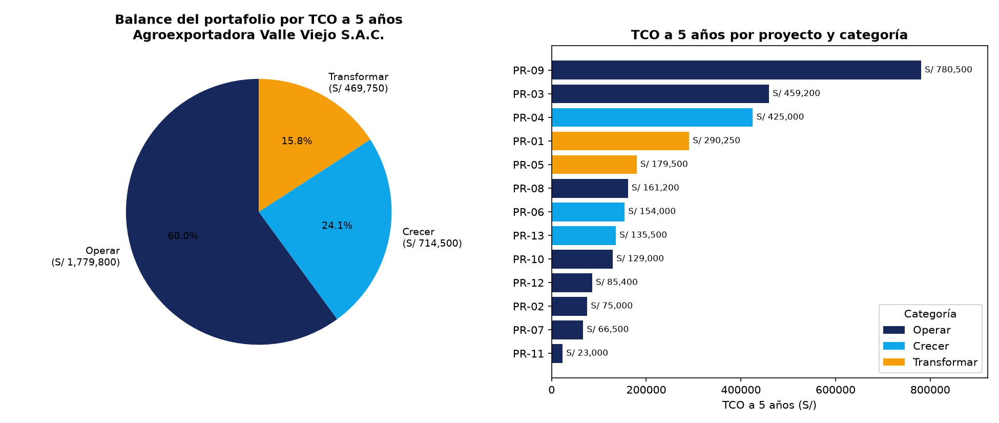
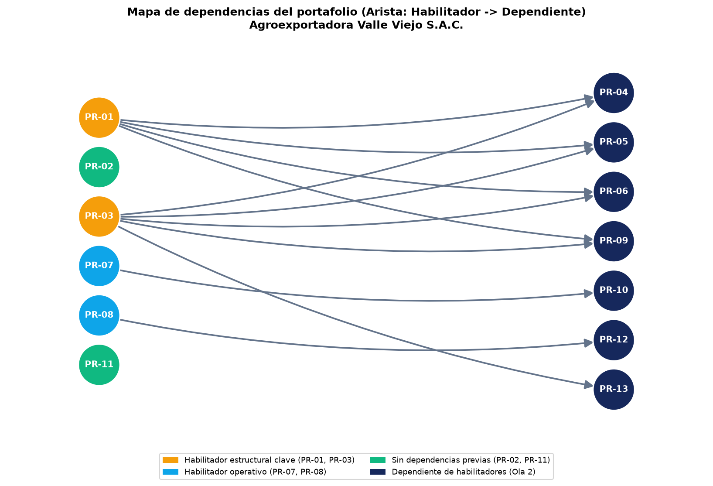

# 7. Plan de Implementación y Portafolio de Proyectos

**Organización:** Agroexportadora Valle Viejo S.A.C. (`EMPRESA-01-agroexportadora-valle-viejo`)  
**Versión del documento:** `v0.13`  
**Clasificación:** Confidencial  

---

## 7.1 Portafolio de proyectos

### 7.1.1 Fuentes admisibles y control de admisión

De acuerdo con la regla de gobierno del portafolio (COBIT 2019 `APO05` y `EDM02`), ningún proyecto ingresa al Plan Estratégico de Tecnologías de Información (PETI) por solicitud directa o preferencia técnica. Todo candidato debe provenir exclusivamente de una de las **cinco fuentes admisibles** trazables al diagnóstico y a la arquitectura objetivo:

| N.º | Fuente admisible | Sección de origen en el PETI | Naturaleza | Proyectos admitidos |
|:---:|---|---|---|:---:|
| **1** | **Obligación normativa** | Sección 4.1.5 | No negociable, con plazo legal (Ley N.º 29733 / D.S. 016-2024-JUS / SUNAFIL) | 1 (`PR-02`) |
| **2** | **Brecha de arquitectura** | Sección 5.4.2 (paquetes de trabajo) | Derivado del análisis de brechas de arquitectura empresarial | 3 (`PR-01`, `PR-03`, `PR-06`) |
| **3** | **Brecha de capacidad de proceso** | Sección 4.3.5 | Derivado de la evaluación de capacidad COBIT 2019 / ITIL (`DSS01`, `DSS02`, `DSS04`, `EDM01`, `APO05`, `EDM02`) | 4 (`PR-07`, `PR-08`, `PR-11`, `PR-12`) |
| **4** | **Estrategia del FODA cruzado** | Sección 3.5 | Derivado del diagnóstico estratégico organizacional (`E-02`, `E-04`, `E-07`) | 3 (`PR-05`, `PR-09`, `PR-10`) |
| **5** | **Brecha de servicio digital** | Sección 6.1.7 | Derivado del catálogo de servicios digitales (`S-01`, `S-02`, `S-06`, `S-07`) | 2 (`PR-04`, `PR-13`) |

#### Diagnóstico de línea base: cómo decidía sus inversiones Agroexportadora Valle Viejo S.A.C.

El análisis de los expedientes históricos (`expedientes-de-inversion.md` e `inversiones_cerradas.csv`) y del registro de pagos (`pagos.csv`) revela tres patologías severas que el control de admisión de esta sección erradica:

1. **Inversiones aprobadas por pedido verbal sin caso de negocio ni medición de beneficios:** En el periodo 2024–2025 la empresa ejecutó **S/ 561,557.38** en tres inversiones (`INV01` Implantación de módulo del ERP por S/ 260,819.96; `INV02` Enlace de datos redundante por S/ 75,773.21 con **+20.6 %** de desviación; e `INV03` Portal de autoservicio por S/ 224,964.21 con **+24.5 %** de desviación). En los tres casos la justificación fue *«lo solicitó el área usuaria por los problemas recurrentes»*, no se elaboró caso de negocio con alternativas, no se firmó acta de aceptación y **en ningún caso se midió si el beneficio declarado se alcanzó**.
2. **Gasto informático oculto (Shadow IT) que cuadruplica el presupuesto oficial de TI:** Mientras el presupuesto anual ejecutado de TI (`presupuesto_ti.csv`) ascendió a **S/ 414,893.28** (S/ 357,898.75 en partidas externas más S/ 56,994.53 en personal de TI), la población de pagos de Tesorería (`pagos.csv`) registra **1,020 pagos bajo el concepto `Servicio informático` por S/ 1,475,059.22** distribuidos en **71 proveedores** y aprobados por 13 empleados distintos, incluyendo **18 pagos auto-aprobados (`registrado_por == aprobado_por`) por S/ 48,144.00**.
3. **Candidatos retirados y fusionados en el control de admisión (`PF01_consolidacion.py`):**

| Código original | Candidato evaluado | Acción de control | Razón documentada |
|:---:|---|---|---|
| `C-16` | Adquisición de software departamental aislado por pedido verbal de área usuaria | **Retirado (No admitido)** | Su fuente (*Solicitud verbal de área usuaria*) no pertenece a las 5 fuentes admisibles. Admitirlo repetiría el defecto de `INV01` e `INV03` y el gasto disperso de `pagos.csv`. |
| `C-17` | Remodelación visual de boletín interno sin indicador asociado | **Retirado (No admitido)** | Carece de objetivo estratégico asociado en la Sección 6.2; no genera contribución verificable a ningún indicador del PETI. |
| `C-05` | Consulta de estado de embarque y lotes fitosanitarios en autoservicio | **Fusionado en `C-04` (`PR-04`)** | Comparte plataforma tecnológica, usuarios (clientes importadores/brokers) y objetivo (`OD-01`) con `C-04`. Se integra como módulo y entregable explícito dentro de `PR-04` sin pérdida de alcance. |
| `C-11` | Programa integral de cumplimiento de datos personales | **Fusionado en `C-02` (`PR-02`)** | Responde a la misma obligación legal (Ley N.º 29733 y D.S. 016-2024-JUS, Sección 4.1.5, `OD-05`) que el Registro de Actividades de Tratamiento (`C-02`), consolidándose en un único proyecto normativo. |

---

### 7.1.2 Portafolio de proyectos

Tras ejecutar el control de admisión y la depuración de duplicados, el portafolio de Agroexportadora Valle Viejo S.A.C. queda conformado por **13 proyectos (`PR-01` a `PR-13`)**:

| Código | Origen | Nombre del proyecto | Fuente admisible | Sección de origen | Objetivo(s) | Categoría |
|:---:|:---:|---|---|---|---|---|
| `PR-01` | `C-01` | Gobierno del dato maestro (lotes agrícolas, productores y clientes) | Brecha de arquitectura | Sección 5.4.2 PT-01 | `OD-02, OD-03` | **Transformar** |
| `PR-02` | `C-02 + C-11` | Programa de cumplimiento de datos personales y Registro de Actividades de Tratamiento (RAT) | Obligación normativa | Sección 4.1.5 | `OD-05` | **Operar** |
| `PR-03` | `C-03` | Capa de integración de servicios API (ERP - Planta - Campo - Aduanas) | Brecha de arquitectura | Sección 5.4.2 PT-02 | `OD-01, OD-03` | **Operar** |
| `PR-04` | `C-04 + C-05` | Rediseño del portal B2B de agroexportación y consulta de embarques en autoservicio | Brecha de servicio digital | Sección 6.1.7 S-01, S-02 | `OD-01` | **Crecer** |
| `PR-05` | `C-06` | Planificación inteligente de rutas de acopio, cadena de frío y trazabilidad de despacho | Estrategia FODA | Sección 3.5 E-02 | `OD-03` | **Transformar** |
| `PR-06` | `C-07` | Tablero de gestión comercial, costos por lote y rentabilidad de exportación | Brecha de arquitectura | Sección 5.4.2 PT-05 | `OD-02` | **Crecer** |
| `PR-07` | `C-08` | Mesa de servicio de TI y control centralizado de proveedores informáticos | Brecha de capacidad | Sección 4.3.5 DSS02 | `OD-04` | **Operar** |
| `PR-08` | `C-09` | Continuidad de infraestructura, conmutación de enlace redundante y respaldo inmutable | Brecha de capacidad | Sección 4.3.5 DSS04 | `OD-04` | **Operar** |
| `PR-09` | `C-10` | Renovación y consolidación de la plataforma del ERP agroindustrial | Estrategia FODA | Sección 3.5 E-04 | `OD-04, OD-03` | **Operar** |
| `PR-10` | `C-12` | Gestión del conocimiento y base de datos de configuración (CMDB) | Estrategia FODA | Sección 3.5 E-07 | `OD-06` | **Operar** |
| `PR-11` | `C-13` | Comité de gobierno e inversiones de TI (casos de negocio y actas de beneficio) | Brecha de capacidad | Sección 4.3.5 EDM01, APO05, EDM02 | `OD-02, OD-04` | **Operar** |
| `PR-12` | `C-14` | Instrumentación de monitoreo y disponibilidad (cámaras de frío, enlace y ERP) | Brecha de capacidad | Sección 4.3.5 DSS01 | `OD-04` | **Operar** |
| `PR-13` | `C-15` | Autoservicio digital de trabajadores de campo y planta (boletas, destajo y vacaciones) | Brecha de servicio digital | Sección 6.1.7 S-06, S-07 | `OD-01, OD-05` | **Crecer** |

---

### 7.1.3 Fichas de proyecto

Cada uno de los 13 proyectos cuenta con su ficha individual estandarizada de **20 campos** en la carpeta `07_portafolio/PF03_fichas/PR-01.md` a `PR-13.md` (y consolidada en el `Anexo B`). A continuación se presenta el registro completo de las 13 fichas:

# Ficha Estandarizada de Proyecto · PR-01

**Organización:** Agroexportadora Valle Viejo S.A.C. (`EMPRESA-01-agroexportadora-valle-viejo`)  
**Sección del PETI:** 7.1.3 Fichas de proyecto  
**Clasificación:** Confidencial  

| N.º | Campo estandarizado | Detalle del proyecto |
|:---:|---|---|
| **1** | **Código del proyecto** | `PR-01` |
| **2** | **Nombre del proyecto** | Gobierno del dato maestro (lotes agrícolas, productores y clientes) |
| **3** | **Fuente y sección de origen** | Brecha de arquitectura · Sección 5.4.2 PT-01 |
| **4** | **Objetivo(s) al que contribuye (Sección 6.2)** | `OD-02, OD-03` |
| **5** | **Categoría del portafolio** | **Transformar** |
| **6** | **Problema u oportunidad que resuelve (con cifra del diagnóstico)** | Inconsistencia de códigos de lotes agrícolas, fundos proveedores y clientes importadores entre planta de empaque, campo y el módulo ERP implantado en INV01 (S/ 260,819.96 ejecutados sin acta ni diccionario de datos), ocasionando reprocesos manuales de conciliación en cada campaña de exportación. |
| **7** | **Alcance incluido** | Catálogo único y diccionario de datos maestros (productores, lotes fitosanitarios SENASA, variedades de cultivo, clientes B2B y proveedores); reglas de calidad de datos; comité de custodia de datos; migración y depuración de maestros actuales. |
| **8** | **Alcance excluido** | Desarrollo de tableros BI comerciales (cubierto en PR-06) y construcción de pasarelas API (cubierto en PR-03). |
| **9** | **Entregables concretos** | 1) Diccionario y modelo canónico de datos maestros; 2) Repositorio centralizado MDM validado; 3) Matriz RACI de propietarios de datos (Data Stewards); 4) Base maestra depurada y migrada sin duplicados. |
| **10** | **Duración estimada (meses)** | 6 meses |
| **11** | **Esfuerzo estimado (persona-mes)** | 12 persona-mes |
| **12** | **Inversión inicial (S/ y rango)** | S/ 55,000 (rango ±30 %: S/ 38,500 – S/ 71,500) |
| **13** | **Costo operativo anual (S/ desglosado)** | S/ 41,850 / año (Licencias: S/ 6,000 + Infraestructura: S/ 3,600 + Soporte 15 %: S/ 8,250 + Personal dedicado: S/ 24,000) |
| **14** | **Costos únicos complementarios y costo de salida** | Costos únicos adicionales: S/ 26,000 (Capacitación: S/ 6,000 + Migración: S/ 12,000 + Integración: S/ 8,000) · Costo de salida estimado: S/ 4,500 (exportación abierta en estándar SQL/CSV). |
| **15** | **Costo Total de Propiedad — TCO a 5 años (S/ y rango)** | **S/ 290,250 (rango ±30 %: S/ 203,175 – S/ 377,325; S/ 294,750 incluyendo costo de salida)** |
| **16** | **Beneficio cuantificado (S/ o métrica del indicador)** | Ahorro de S/ 92,000/año por eliminación de 1,450 horas/año de reproceso en conciliación de lotes de acopio y facturación de exportación; reducción de errores de codificación fitosanitaria de 8.4 % a < 0.5 %. |
| **17** | **Dependencias (proyectos de los que depende y proyectos que habilita)** | No depende de ningún proyecto previo (inicia en Ola 1). Habilita estructuralmente a 4 proyectos: PR-04, PR-05, PR-06 y PR-09. |
| **18** | **Riesgos principales y su tratamiento** | Resistencia de las áreas de Acopio, Planta y Administración a ceder el alta libre de códigos en el ERP -> Mitigación: bloqueo técnico de altas sin validación MDM y patrocinio de Gerencia General. |
| **19** | **Responsable propuesto (cargo) y Área usuaria** | **Responsable:** Jefe de TI / Arquitecto de Datos (en coordinación con Karla Cáceres Salazar) · **Área usuaria:** Operaciones Agrícolas, Planta de Empaque, Comercial y Administración y Finanzas |
| **20** | **Criterio de éxito (con umbral verificable)** | 100 % de lotes de exportación, productores y clientes registrados bajo código único validado, con < 0.5 % de duplicidad al sexto mes. |

---

# Ficha Estandarizada de Proyecto · PR-02

**Organización:** Agroexportadora Valle Viejo S.A.C. (`EMPRESA-01-agroexportadora-valle-viejo`)  
**Sección del PETI:** 7.1.3 Fichas de proyecto  
**Clasificación:** Confidencial  

| N.º | Campo estandarizado | Detalle del proyecto |
|:---:|---|---|
| **1** | **Código del proyecto** | `PR-02` |
| **2** | **Nombre del proyecto** | Programa de cumplimiento de datos personales y Registro de Actividades de Tratamiento (RAT) |
| **3** | **Fuente y sección de origen** | Obligación normativa · Sección 4.1.5 (Fusión de C-02 + C-11) |
| **4** | **Objetivo(s) al que contribuye (Sección 6.2)** | `OD-05` |
| **5** | **Categoría del portafolio** | **Operar** |
| **6** | **Problema u oportunidad que resuelve (con cifra del diagnóstico)** | Agroexportadora Valle Viejo S.A.C. administra datos sensibles y biométricos/planillas de más de 1,200 trabajadores de campo y planta, productores y contactos comerciales sin inscripción de bancos de datos ni RAT actualizado ante la ANPD (Ley N.º 29733 y D.S. 016-2024-JUS), exponiéndose a multas graves de 5 a 50 UIT. |
| **7** | **Alcance incluido** | Elaboración del Registro de Actividades de Tratamiento (RAT, de C-02); inscripción de bancos de datos personales (trabajadores, productores, clientes, videovigilancia) ante la ANPD; cláusulas de consentimiento informado y políticas de privacidad; procedimiento de atención de derechos ARCO y notificación de incidentes (de C-11). |
| **8** | **Alcance excluido** | Implementación de portal web de boletas de pago (cubierto en PR-13) y despliegue de respaldos inmutables de servidores (cubierto en PR-08). |
| **9** | **Entregables concretos** | 1) Registro de Actividades de Tratamiento (RAT) aprobado; 2) Resoluciones de inscripción de 4 bancos de datos ante la ANPD; 3) Formatos legales de consentimiento de jornaleros, proveedores y clientes; 4) Protocolo ARCO y actas de capacitación al personal administrativo. |
| **10** | **Duración estimada (meses)** | 3 meses |
| **11** | **Esfuerzo estimado (persona-mes)** | 5 persona-mes |
| **12** | **Inversión inicial (S/ y rango)** | S/ 18,000 (rango ±20 %: S/ 14,400 – S/ 21,600) |
| **13** | **Costo operativo anual (S/ desglosado)** | S/ 10,800 / año (Licencias: S/ 0 + Infraestructura: S/ 0 + Soporte/Auditoría legal 10 %: S/ 1,800 + Personal dedicado: S/ 9,000) |
| **14** | **Costos únicos complementarios y costo de salida** | Costos únicos adicionales: S/ 3,000 (Capacitación inicial: S/ 3,000) · Costo de salida estimado: S/ 1,500 (archivo documental normativo propio). |
| **15** | **Costo Total de Propiedad — TCO a 5 años (S/ y rango)** | **S/ 75,000 (rango ±20 %: S/ 60,000 – S/ 90,000; S/ 76,500 incluyendo costo de salida)** |
| **16** | **Beneficio cuantificado (S/ o métrica del indicador)** | Riesgo legal evitado cuantificado en S/ 128,750/año (probabilidad de fiscalización 50 % × multa media de 50 UIT = S/ 257,500 ante la ANPD / SUNAFIL). |
| **17** | **Dependencias (proyectos de los que depende y proyectos que habilita)** | Sin dependencias previas (inicia en Ola 1). No bloquea técnicamente a otros proyectos, pero resguarda legalmente a PR-04 y PR-13. |
| **18** | **Riesgos principales y su tratamiento** | Demora en la firma de consentimientos físicos de trabajadores temporales de campaña -> Mitigación: incorporación obligatoria en el kit de contratación de RR.HH. antes del ingreso a fundo. |
| **19** | **Responsable propuesto (cargo) y Área usuaria** | **Responsable:** Oficial de Datos Personales / Asesoría Legal y Jefatura de TI · **Área usuaria:** Recursos Humanos, Administración y Finanzas, Comercial |
| **20** | **Criterio de éxito (con umbral verificable)** | 100 % de bancos de datos inscritos ante la ANPD, RAT vigente y 100 % de contratos y portales con cláusulas de protección de datos al mes 3. |

---

# Ficha Estandarizada de Proyecto · PR-03

**Organización:** Agroexportadora Valle Viejo S.A.C. (`EMPRESA-01-agroexportadora-valle-viejo`)  
**Sección del PETI:** 7.1.3 Fichas de proyecto  
**Clasificación:** Confidencial  

| N.º | Campo estandarizado | Detalle del proyecto |
|:---:|---|---|
| **1** | **Código del proyecto** | `PR-03` |
| **2** | **Nombre del proyecto** | Capa de integración de servicios API (ERP - Planta - Campo - Aduanas) |
| **3** | **Fuente y sección de origen** | Brecha de arquitectura · Sección 5.4.2 PT-02 |
| **4** | **Objetivo(s) al que contribuye (Sección 6.2)** | `OD-01, OD-03` |
| **5** | **Categoría del portafolio** | **Operar** |
| **6** | **Problema u oportunidad que resuelve (con cifra del diagnóstico)** | El portal de autoservicio (INV03: S/ 224,964.21 ejecutados con +24.5 % de sobrecosto) y las balanzas/sistemas de planta consultan o cargan datos directamente o mediante archivos Excel al ERP (INV01: S/ 260,819.96), generando acoplamiento frágil, doble digitación y pagos reactivos dispersos en 71 proveedores informáticos (S/ 1,475,059.22 en pagos.csv). |
| **7** | **Alcance incluido** | Despliegue de pasarela API Gateway empresarial; diseño y publicación de servicios REST/eventos para lotes agrícolas, recepción en planta, stock de cámaras de frío, pedidos de exportación y boletas RR.HH.; seguridad OAuth2/JWT, control de tráfico y logs de auditoría. |
| **8** | **Alcance excluido** | Rediseño de la interfaz de usuario del portal B2B (cubierto en PR-04) y migración del motor de base de datos del ERP (cubierto en PR-09). |
| **9** | **Entregables concretos** | 1) Pasarela API Gateway en alta disponibilidad; 2) Catálogo OpenAPI/Swagger con 12 servicios expuestos y documentados; 3) Conectores desacoplados ERP–Planta–Portal; 4) Tablero de telemetría y seguridad de APIs. |
| **10** | **Duración estimada (meses)** | 8 meses |
| **11** | **Esfuerzo estimado (persona-mes)** | 18 persona-mes |
| **12** | **Inversión inicial (S/ y rango)** | S/ 78,000 (rango ±40 %: S/ 46,800 – S/ 109,200) |
| **13** | **Costo operativo anual (S/ desglosado)** | S/ 71,640 / año (Licencias: S/ 12,000 + Infraestructura: S/ 9,600 + Soporte 18 %: S/ 14,040 + Personal dedicado: S/ 36,000) |
| **14** | **Costos únicos complementarios y costo de salida** | Costos únicos adicionales: S/ 23,000 (Capacitación: S/ 8,000 + Integración inicial: S/ 15,000) · Costo de salida estimado: S/ 6,500 (especificaciones OpenAPI estándar portables). |
| **15** | **Costo Total de Propiedad — TCO a 5 años (S/ y rango)** | **S/ 459,200 (rango ±40 %: S/ 275,520 – S/ 642,880; S/ 465,700 incluyendo costo de salida)** |
| **16** | **Beneficio cuantificado (S/ o métrica del indicador)** | Ahorro y riesgo evitado de S/ 138,000/año (eliminación de integraciones ad-hoc contratadas en pagos.csv, reducción de 2,100 horas/año de digitación duplicada entre planta y ERP, y habilitación de 5 proyectos del portafolio). |
| **17** | **Dependencias (proyectos de los que depende y proyectos que habilita)** | No depende de ningún proyecto previo (inicia en Ola 1). Es el principal habilitador estructural del portafolio: habilita 5 proyectos (PR-04, PR-05, PR-06, PR-09 y PR-13). |
| **18** | **Riesgos principales y su tratamiento** | Falta de documentación técnica de las tablas del ERP implantado en INV01 -> Mitigación: ingeniería inversa controlada sobre entorno de pruebas con participación del proveedor del ERP. |
| **19** | **Responsable propuesto (cargo) y Área usuaria** | **Responsable:** Arquitecto de Integración / Jefe de TI · **Área usuaria:** Todas las áreas operativas (Planta de Empaque, Acopio, Comercial, RR.HH. y Finanzas) |
| **20** | **Criterio de éxito (con umbral verificable)** | 0 accesos directos de aplicaciones externas a la base de datos del ERP y >= 99.5 % de disponibilidad en las 12 APIs publicadas al octavo mes. |

---

# Ficha Estandarizada de Proyecto · PR-04

**Organización:** Agroexportadora Valle Viejo S.A.C. (`EMPRESA-01-agroexportadora-valle-viejo`)  
**Sección del PETI:** 7.1.3 Fichas de proyecto  
**Clasificación:** Confidencial  

| N.º | Campo estandarizado | Detalle del proyecto |
|:---:|---|---|
| **1** | **Código del proyecto** | `PR-04` |
| **2** | **Nombre del proyecto** | Rediseño del portal B2B de agroexportación y consulta de embarques en autoservicio |
| **3** | **Fuente y sección de origen** | Brecha de servicio digital · Sección 6.1.7 S-01, S-02 (Fusión de C-04 + C-05) |
| **4** | **Objetivo(s) al que contribuye (Sección 6.2)** | `OD-01` |
| **5** | **Categoría del portafolio** | **Crecer** |
| **6** | **Problema u oportunidad que resuelve (con cifra del diagnóstico)** | En 2024 Agroexportadora Valle Viejo ejecutó S/ 224,964.21 en el 'Portal de autoservicio' (Expediente 3 - INV03, responsable Luis Copaja Mamani, desviación +24.5 %) sin caso de negocio, sin acta de aceptación y sin medir beneficios. El portal presenta problemas recurrentes, no muestra trazabilidad de embarques ni certificados fitosanitarios y obliga a atender consultas de clientes e importadores por correo y teléfono. |
| **7** | **Alcance incluido** | Rediseño funcional y técnico del portal B2B (C-04) desacoplado del ERP mediante PR-03; módulo de consulta en tiempo real de estado de pedidos, contenedores refrigerados, packing list y certificados SENASA en autoservicio (C-05); despliegue en 2 etapas con validación de adopción al mes 5. |
| **8** | **Alcance excluido** | Sistema de gestión de rutas internas de camiones de campo (cubierto en PR-05) y pasarela de cobro minorista B2C (la empresa opera en modelo B2B agroexportador). |
| **9** | **Entregables concretos** | 1) Portal web B2B responsivo integrado vía API Gateway (PR-03); 2) Módulo de seguimiento de embarques, lotes y descarga de dossier de exportación (packing list, BL, certificado fitosanitario); 3) Panel de métricas de adopción por cliente importador; 4) Acta de aceptación formal y medición de línea base. |
| **10** | **Duración estimada (meses)** | 9 meses |
| **11** | **Esfuerzo estimado (persona-mes)** | 20 persona-mes |
| **12** | **Inversión inicial (S/ y rango)** | S/ 92,000 (rango ±35 %: S/ 59,800 – S/ 124,200) |
| **13** | **Costo operativo anual (S/ desglosado)** | S/ 59,400 / año (Licencias: S/ 8,400 + Infraestructura: S/ 7,200 + Soporte 15 %: S/ 13,800 + Personal dedicado: S/ 30,000) |
| **14** | **Costos únicos complementarios y costo de salida** | Costos únicos adicionales: S/ 36,000 (Capacitación: S/ 12,000 + Migración: S/ 6,000 + Integración: S/ 18,000) · Costo de salida estimado: S/ 7,500. |
| **15** | **Costo Total de Propiedad — TCO a 5 años (S/ y rango)** | **S/ 425,000 (rango ±35 %: S/ 276,250 – S/ 573,750; S/ 432,500 incluyendo costo de salida)** |
| **16** | **Beneficio cuantificado (S/ o métrica del indicador)** | Beneficio cuantificado de S/ 145,000/año (liberación de 1,850 horas/año del equipo comercial y de exportaciones en envío manual de documentos de embarque, reducción de penalidades por demora documental y rescate del activo INV03). |
| **17** | **Dependencias (proyectos de los que depende y proyectos que habilita)** | Depende de PR-01 (Gobierno del dato maestro) y PR-03 (Capa de integración de servicios API). No habilita a otros proyectos. |
| **18** | **Riesgos principales y su tratamiento** | Baja adopción de clientes e importadores acostumbrados a pedir estatus por WhatsApp/correo -> Mitigación: ejecución en 2 etapas (Etapa 1 valida umbral > 25 % de adopción antes de liberar Etapa 2) y envío automático de enlace de tracking. |
| **19** | **Responsable propuesto (cargo) y Área usuaria** | **Responsable:** Jefe de Aplicaciones / Líder Comercial de Exportaciones (en coordinación con Luis Copaja Mamani) · **Área usuaria:** Comercial, Comercio Exterior / Exportaciones y Aseguramiento de la Calidad |
| **20** | **Criterio de éxito (con umbral verificable)** | >= 65 % de clientes importadores/brokers consultando embarques y descargando documentación fitosanitaria en autoservicio sin intervención telefónica al mes 9. |

---

# Ficha Estandarizada de Proyecto · PR-05

**Organización:** Agroexportadora Valle Viejo S.A.C. (`EMPRESA-01-agroexportadora-valle-viejo`)  
**Sección del PETI:** 7.1.3 Fichas de proyecto  
**Clasificación:** Confidencial  

| N.º | Campo estandarizado | Detalle del proyecto |
|:---:|---|---|
| **1** | **Código del proyecto** | `PR-05` |
| **2** | **Nombre del proyecto** | Planificación inteligente de rutas de acopio, cadena de frío y trazabilidad de despacho |
| **3** | **Fuente y sección de origen** | Estrategia FODA · Sección 3.5 E-02 |
| **4** | **Objetivo(s) al que contribuye (Sección 6.2)** | `OD-03` |
| **5** | **Categoría del portafolio** | **Transformar** |
| **6** | **Problema u oportunidad que resuelve (con cifra del diagnóstico)** | La programación de recojo de cosecha en fundos del Valle Viejo y el control de temperatura desde el acopio hasta el despacho de contenedores refrigerados se gestiona en hojas de cálculo aisladas, generando mermas por ruptura de cadena de frío, tiempos muertos de transporte (S/ 1,509,984.67 en Servicio de transporte y S/ 1,650,557.88 en Combustible en pagos.csv) y demoras en el cierre de lotes. |
| **7** | **Alcance incluido** | Módulo de planificación de rutas de acopio agrícola; registro móvil de recepción de jabas/pallets por lote en campo y planta; integración de sensores de temperatura de cadena de frío y trazabilidad de despacho de contenedores. |
| **8** | **Alcance excluido** | Compra de flota propia de camiones refrigerados (el transporte se contrata como servicio) y renovación del ERP contable (PR-09). |
| **9** | **Entregables concretos** | 1) Aplicación web/móvil de ruteo de acopio y trazabilidad de lotes; 2) Integración de lecturas de cadena de frío por pallet/contenedor; 3) Conector API con ERP y portal B2B; 4) Reporte auditable de trazabilidad campo-a-puerto para SENASA y certificaciones GlobalG.A.P. |
| **10** | **Duración estimada (meses)** | 5 meses |
| **11** | **Esfuerzo estimado (persona-mes)** | 10 persona-mes |
| **12** | **Inversión inicial (S/ y rango)** | S/ 34,000 (rango ±30 %: S/ 23,800 – S/ 44,200) |
| **13** | **Costo operativo anual (S/ desglosado)** | S/ 25,500 / año (Licencias: S/ 4,800 + Infraestructura: S/ 3,600 + Soporte 15 %: S/ 5,100 + Personal dedicado: S/ 12,000) |
| **14** | **Costos únicos complementarios y costo de salida** | Costos únicos adicionales: S/ 18,000 (Capacitación: S/ 4,000 + Migración: S/ 5,000 + Integración: S/ 9,000) · Costo de salida estimado: S/ 3,000. |
| **15** | **Costo Total de Propiedad — TCO a 5 años (S/ y rango)** | **S/ 179,500 (rango ±30 %: S/ 125,650 – S/ 233,350; S/ 182,500 incluyendo costo de salida)** |
| **16** | **Beneficio cuantificado (S/ o métrica del indicador)** | Ahorro de S/ 96,000/año (reducción del 3.5 % en gasto de fletes y combustible de acopio sobre la base de pagos.csv y disminución de 1.2 % en merma por deshidratación/cadena de frío). |
| **17** | **Dependencias (proyectos de los que depende y proyectos que habilita)** | Depende de PR-01 (Gobierno del dato maestro de lotes y fundos) y PR-03 (Capa de integración de servicios API). |
| **18** | **Riesgos principales y su tratamiento** | Zonas agrícolas del valle con cobertura celular intermitente -> Mitigación: modo offline con sincronización diferida automática al llegar a planta de empaque. |
| **19** | **Responsable propuesto (cargo) y Área usuaria** | **Responsable:** Coordinador de Sistemas Operativos / Jefe de Logística y Planta · **Área usuaria:** Acopio Agrícola, Planta de Empaque, Frío y Despacho |
| **20** | **Criterio de éxito (con umbral verificable)** | 100 % de lotes de exportación con trazabilidad digital completa desde fundo hasta contenedor y reducción >= 20 % en el tiempo de despacho al quinto mes. |

---

# Ficha Estandarizada de Proyecto · PR-06

**Organización:** Agroexportadora Valle Viejo S.A.C. (`EMPRESA-01-agroexportadora-valle-viejo`)  
**Sección del PETI:** 7.1.3 Fichas de proyecto  
**Clasificación:** Confidencial  

| N.º | Campo estandarizado | Detalle del proyecto |
|:---:|---|---|
| **1** | **Código del proyecto** | `PR-06` |
| **2** | **Nombre del proyecto** | Tablero de gestión comercial, costos por lote y rentabilidad de exportación |
| **3** | **Fuente y sección de origen** | Brecha de arquitectura · Sección 5.4.2 PT-05 |
| **4** | **Objetivo(s) al que contribuye (Sección 6.2)** | `OD-02` |
| **5** | **Categoría del portafolio** | **Crecer** |
| **6** | **Problema u oportunidad que resuelve (con cifra del diagnóstico)** | La Gerencia General y Administración y Finanzas carecen de visibilidad oportuna de la rentabilidad por lote exportado, variedad, cliente y campaña; los reportes tardan hasta 12 días tras el cierre mensual porque se consolidan manualmente desde el ERP (INV01) y planillas contables. |
| **7** | **Alcance incluido** | Data mart comercial y de costos agroindustriales; tableros ejecutivos automatizados de margen por lote/contenedor, ejecución presupuestal de TI y seguimiento de beneficios de inversiones (cerrando la brecha de medición detectada en INV01, INV02 e INV03). |
| **8** | **Alcance excluido** | Modelos predictivos de precios internacionales de commodities con IA (fuera de horizonte actual) y modificación de asientos en el ERP. |
| **9** | **Entregables concretos** | 1) Modelo dimensional de rentabilidad por lote, calibre y destino; 2) 5 tableros gerenciales (Comercial, Costos de Planta/Campo, Logística, Presupuesto y Beneficios TI); 3) Automatización de ingesta diaria vía PR-03. |
| **10** | **Duración estimada (meses)** | 4 meses |
| **11** | **Esfuerzo estimado (persona-mes)** | 8 persona-mes |
| **12** | **Inversión inicial (S/ y rango)** | S/ 28,000 (rango ±25 %: S/ 21,000 – S/ 35,000) |
| **13** | **Costo operativo anual (S/ desglosado)** | S/ 22,200 / año (Licencias: S/ 3,600 + Infraestructura: S/ 2,400 + Soporte 15 %: S/ 4,200 + Personal dedicado: S/ 12,000) |
| **14** | **Costos únicos complementarios y costo de salida** | Costos únicos adicionales: S/ 15,000 (Capacitación: S/ 5,000 + Migración: S/ 3,000 + Integración: S/ 7,000) · Costo de salida estimado: S/ 2,500. |
| **15** | **Costo Total de Propiedad — TCO a 5 años (S/ y rango)** | **S/ 154,000 (rango ±25 %: S/ 115,500 – S/ 192,500; S/ 156,500 incluyendo costo de salida)** |
| **16** | **Beneficio cuantificado (S/ o métrica del indicador)** | Reducción del tiempo de generación de reportes gerenciales de 12 días a actualización diaria (< 24 h) y ahorro de S/ 54,000/año en horas de analistas financieros y comerciales. |
| **17** | **Dependencias (proyectos de los que depende y proyectos que habilita)** | Depende de PR-01 (Gobierno del dato maestro) y PR-03 (Capa de integración de servicios API). |
| **18** | **Riesgos principales y su tratamiento** | Discrepancia en criterios de prorrateo de costos indirectos de planta de empaque -> Mitigación: definición y firma previa de reglas de costeo con Administración y Finanzas. |
| **19** | **Responsable propuesto (cargo) y Área usuaria** | **Responsable:** Analista de Inteligencia de Negocios / Jefe de Administración y Finanzas · **Área usuaria:** Gerencia General, Comercial, Administración y Finanzas |
| **20** | **Criterio de éxito (con umbral verificable)** | Cierre de rentabilidad por lote disponible en <= 24 horas tras el embarque con 0 diferencias frente al balance contable del ERP. |

---

# Ficha Estandarizada de Proyecto · PR-07

**Organización:** Agroexportadora Valle Viejo S.A.C. (`EMPRESA-01-agroexportadora-valle-viejo`)  
**Sección del PETI:** 7.1.3 Fichas de proyecto  
**Clasificación:** Confidencial  

| N.º | Campo estandarizado | Detalle del proyecto |
|:---:|---|---|
| **1** | **Código del proyecto** | `PR-07` |
| **2** | **Nombre del proyecto** | Mesa de servicio de TI y control centralizado de proveedores informáticos |
| **3** | **Fuente y sección de origen** | Brecha de capacidad · Sección 4.3.5 DSS02 |
| **4** | **Objetivo(s) al que contribuye (Sección 6.2)** | `OD-04` |
| **5** | **Categoría del portafolio** | **Operar** |
| **6** | **Problema u oportunidad que resuelve (con cifra del diagnóstico)** | Las incidencias de usuarios y los requerimientos a proveedores de TI se gestionan de manera informal, lo que ha derivado en 1,020 pagos por 'Servicio informático' (S/ 1,475,059.22 en pagos.csv) repartidos en 71 proveedores y aprobados por 13 empleados distintos (incluyendo 18 pagos auto-aprobados por S/ 48,144.00), además de un sobrecosto de +17.9 % en la partida PT02 de soporte. |
| **7** | **Alcance incluido** | Implantación de plataforma ITSM de Mesa de Servicio (incidentes, requerimientos y niveles de servicio SLA); catálogo de servicios de TI; flujo obligatorio de validación técnica previa a toda orden de compra de 'Servicio informático' y homologación de proveedores. |
| **8** | **Alcance excluido** | Inventario automatizado de configuración y activos (cubierto en PR-10). |
| **9** | **Entregables concretos** | 1) Herramienta de Mesa de Servicio configurada con colas, prioridades y SLA; 2) Procedimiento DSS02 y bloqueo de órdenes de compra informáticas sin ticket de conformidad técnica; 3) Padrón depurado y homologado de proveedores de TI (reducción de 71 a <= 12 proveedores autorizados). |
| **10** | **Duración estimada (meses)** | 3 meses |
| **11** | **Esfuerzo estimado (persona-mes)** | 5 persona-mes |
| **12** | **Inversión inicial (S/ y rango)** | S/ 15,000 (rango ±20 %: S/ 12,000 – S/ 18,000) |
| **13** | **Costo operativo anual (S/ desglosado)** | S/ 9,300 / año (Licencias: S/ 0 [Open Source] + Infraestructura: S/ 1,800 + Soporte 10 %: S/ 1,500 + Personal dedicado: S/ 6,000) |
| **14** | **Costos únicos complementarios y costo de salida** | Costos únicos adicionales: S/ 5,000 (Capacitación: S/ 3,000 + Integración correo/AD: S/ 2,000) · Costo de salida estimado: S/ 1,200. |
| **15** | **Costo Total de Propiedad — TCO a 5 años (S/ y rango)** | **S/ 66,500 (rango ±20 %: S/ 53,200 – S/ 79,800; S/ 67,700 incluyendo costo de salida)** |
| **16** | **Beneficio cuantificado (S/ o métrica del indicador)** | Ahorro directo estimado de S/ 185,000/año al eliminar servicios informáticos duplicados, fraccionados o sin conformidad técnica sobre la bolsa de S/ 1,475,059.22 detectada en pagos.csv. |
| **17** | **Dependencias (proyectos de los que depende y proyectos que habilita)** | No depende de ningún proyecto previo (inicia en Ola 1). Habilita a PR-10 (Gestión del conocimiento y CMDB). |
| **18** | **Riesgos principales y su tratamiento** | Compras directas de áreas usuarias eludiendo la Mesa de Servicio -> Mitigación: regla en Administración y Finanzas que impide pagar comprobantes de 'Servicio informático' sin número de ticket y acta en PR-07. |
| **19** | **Responsable propuesto (cargo) y Área usuaria** | **Responsable:** Coordinador de Soporte y Operaciones de TI · **Área usuaria:** Toda la organización y Administración y Finanzas (Compras/Tesorería) |
| **20** | **Criterio de éxito (con umbral verificable)** | >= 95 % de incidentes y 100 % de órdenes de servicio informático registradas y aprobadas a través de la Mesa de Servicio con cumplimiento de SLA >= 90 %. |

---

# Ficha Estandarizada de Proyecto · PR-08

**Organización:** Agroexportadora Valle Viejo S.A.C. (`EMPRESA-01-agroexportadora-valle-viejo`)  
**Sección del PETI:** 7.1.3 Fichas de proyecto  
**Clasificación:** Confidencial  

| N.º | Campo estandarizado | Detalle del proyecto |
|:---:|---|---|
| **1** | **Código del proyecto** | `PR-08` |
| **2** | **Nombre del proyecto** | Continuidad de infraestructura, conmutación de enlace redundante y respaldo inmutable |
| **3** | **Fuente y sección de origen** | Brecha de capacidad · Sección 4.3.5 DSS04 |
| **4** | **Objetivo(s) al que contribuye (Sección 6.2)** | `OD-04` |
| **5** | **Categoría del portafolio** | **Operar** |
| **6** | **Problema u oportunidad que resuelve (con cifra del diagnóstico)** | En 2025 se ejecutaron S/ 75,773.21 (+20.6 % de desviación) en el 'Enlace de datos redundante' (Expediente 2 - INV02, responsable Carlos Apaza Ancco) sin acta de aceptación ni pruebas de conmutación automática (failover), y la organización carece de copias de respaldo inmutables fuera de sede para proteger el ERP y los registros de exportación ante ransomware o siniestros en planta. |
| **7** | **Alcance incluido** | Configuración de balanceo y failover automático SD-WAN sobre el enlace redundante existente (INV02); implementación de respaldos 3-2-1 con repositorio inmutable en nube/off-site; Plan de Continuidad Tecnológica (DRP) y pruebas semestrales de restauración. |
| **8** | **Alcance excluido** | Instrumentación de monitoreo de aplicaciones y sensores de cámaras de frío (cubierto en PR-12). |
| **9** | **Entregables concretos** | 1) Failover automático operativo y certificado sobre los enlaces de planta y sede administrativa; 2) Sistema de respaldo automático 3-2-1 con inmutabilidad activada; 3) Plan de Recuperación ante Desastres (DRP) con RPO <= 4 h y RTO <= 2 h; 4) Acta de prueba exitosa de restauración y conmutación. |
| **10** | **Duración estimada (meses)** | 4 meses |
| **11** | **Esfuerzo estimado (persona-mes)** | 6 persona-mes |
| **12** | **Inversión inicial (S/ y rango)** | S/ 42,000 (rango ±25 %: S/ 31,500 – S/ 52,500) |
| **13** | **Costo operativo anual (S/ desglosado)** | S/ 23,040 / año (Licencias: S/ 0 + Infraestructura cloud/almacenamiento inmutable: S/ 6,000 + Soporte 12 %: S/ 5,040 + Personal dedicado: S/ 12,000) |
| **14** | **Costos únicos complementarios y costo de salida** | Costos únicos adicionales: S/ 4,000 (Capacitación inicial: S/ 4,000) · Costo de salida estimado: S/ 3,500. |
| **15** | **Costo Total de Propiedad — TCO a 5 años (S/ y rango)** | **S/ 161,200 (rango ±25 %: S/ 120,900 – S/ 201,500; S/ 164,700 incluyendo costo de salida)** |
| **16** | **Beneficio cuantificado (S/ o métrica del indicador)** | Riesgo evitado de S/ 160,000/año por parálisis de despacho de contenedores y facturación electrónica durante campaña agrícola, rentabilizando además la inversión previa INV02 de S/ 75,773.21. |
| **17** | **Dependencias (proyectos de los que depende y proyectos que habilita)** | No depende de ningún proyecto previo (inicia en Ola 1). Habilita a PR-12 (Instrumentación de monitoreo y disponibilidad). |
| **18** | **Riesgos principales y su tratamiento** | Ancho de banda insuficiente en horarios pico de copia hacia repositorio externo -> Mitigación: ventanas de replicación incremental nocturna con deduplicación. |
| **19** | **Responsable propuesto (cargo) y Área usuaria** | **Responsable:** Administrador de Redes e Infraestructura (en coordinación con Carlos Apaza Ancco) · **Área usuaria:** Planta de Empaque, Despacho, Facturación y TI |
| **20** | **Criterio de éxito (con umbral verificable)** | Tiempo de conmutación de enlace < 30 segundos, RPO <= 4 horas y RTO <= 2 horas verificados mediante simulacro documentado al cuarto mes. |

---

# Ficha Estandarizada de Proyecto · PR-09

**Organización:** Agroexportadora Valle Viejo S.A.C. (`EMPRESA-01-agroexportadora-valle-viejo`)  
**Sección del PETI:** 7.1.3 Fichas de proyecto  
**Clasificación:** Confidencial  

| N.º | Campo estandarizado | Detalle del proyecto |
|:---:|---|---|
| **1** | **Código del proyecto** | `PR-09` |
| **2** | **Nombre del proyecto** | Renovación y consolidación de la plataforma del ERP agroindustrial |
| **3** | **Fuente y sección de origen** | Estrategia FODA · Sección 3.5 E-04 |
| **4** | **Objetivo(s) al que contribuye (Sección 6.2)** | `OD-04, OD-03` |
| **5** | **Categoría del portafolio** | **Operar** |
| **6** | **Problema u oportunidad que resuelve (con cifra del diagnóstico)** | En 2025 se gastaron S/ 260,819.96 en la 'Implantación de módulo del ERP' (Expediente 1 - INV01, responsable Karla Cáceres Salazar) por pedido verbal del área usuaria, sin caso de negocio, sin acta de aceptación y sin medir beneficios. El núcleo del ERP sigue en versión próxima a fin de soporte, con módulos desconectados de planta y campo, provocando que la partida PT02 (Soporte y mantenimiento) se desvíe +17.9 % (S/ 92,315.88) y que proliferen gastos externos en pagos.csv. |
| **7** | **Alcance incluido** | Actualización a la versión soportada del ERP agroindustrial; remediación y cierre formal del módulo implantado en INV01; integración nativa vía PR-03 con datos maestros gobernados por PR-01; parametrización de costeo agrícola por fundo/lote y régimen agrario; capacitación certificada y acta de aceptación con línea base de beneficios. |
| **8** | **Alcance excluido** | Reemplazo por un ERP de otro fabricante desde cero (descartado en el caso de negocio por su mayor TCO de S/ 1,060,000 y riesgo en campaña). |
| **9** | **Entregables concretos** | 1) Plataforma ERP en versión vigente con soporte oficial garantizado por 5 años; 2) Módulos de Costos Agrícolas, Almacenes/Empaque, Contabilidad y Exportaciones unificados; 3) Migración auditada sobre maestros de PR-01 e integración vía PR-03; 4) Acta de aceptación y medición trimestral de beneficios. |
| **10** | **Duración estimada (meses)** | 12 meses |
| **11** | **Esfuerzo estimado (persona-mes)** | 28 persona-mes |
| **12** | **Inversión inicial (S/ y rango)** | S/ 145,000 (rango ±50 %: S/ 72,500 – S/ 217,500) |
| **13** | **Costo operativo anual (S/ desglosado)** | S/ 110,100 / año (Licencias: S/ 24,000 + Infraestructura: S/ 12,000 + Soporte 18 %: S/ 26,100 + Personal dedicado: S/ 48,000) |
| **14** | **Costos únicos complementarios y costo de salida** | Costos únicos adicionales: S/ 85,000 (Capacitación: S/ 20,000 + Migración: S/ 35,000 + Integración: S/ 30,000) · Costo de salida estimado: S/ 18,000 (extracción estructurada y desencriptación de históricos). |
| **15** | **Costo Total de Propiedad — TCO a 5 años (S/ y rango)** | **S/ 780,500 (rango ±50 %: S/ 390,250 – S/ 1,170,750; S/ 798,500 incluyendo costo de salida)** |
| **16** | **Beneficio cuantificado (S/ o métrica del indicador)** | Beneficio cuantificado de S/ 235,000/año (S/ 1,175,000 en 5 años): reducción de S/ 145,000/año en servicios informáticos correctivos dispersos (pagos.csv) y S/ 90,000/año por eliminación de reprocesos contables, tributarios y de liquidación de campañas. |
| **17** | **Dependencias (proyectos de los que depende y proyectos que habilita)** | Depende de PR-01 (Gobierno del dato maestro) y PR-03 (Capa de integración de servicios API). No puede iniciar su migración productiva sin ambos habilitadores. |
| **18** | **Riesgos principales y su tratamiento** | Interrupción de facturación y guías de remisión durante ventana de cosecha pico -> Mitigación: despliegue por fases fuera de campaña alta y marcha blanca en paralelo durante 30 días. |
| **19** | **Responsable propuesto (cargo) y Área usuaria** | **Responsable:** Jefe de Proyecto ERP / Jefatura de TI (en coordinación con Karla Cáceres Salazar) · **Área usuaria:** Administración y Finanzas, Contabilidad, Operaciones Agrícolas, Planta y Logística |
| **20** | **Criterio de éxito (con umbral verificable)** | 100 % de procesos contables, logísticos y de costeo por lote operando en la versión soportada del ERP, con cierre contable mensual reducido de 10 a 3 días hábiles y 0 hallazgos de soporte sin cobertura. |

---

# Ficha Estandarizada de Proyecto · PR-10

**Organización:** Agroexportadora Valle Viejo S.A.C. (`EMPRESA-01-agroexportadora-valle-viejo`)  
**Sección del PETI:** 7.1.3 Fichas de proyecto  
**Clasificación:** Confidencial  

| N.º | Campo estandarizado | Detalle del proyecto |
|:---:|---|---|
| **1** | **Código del proyecto** | `PR-10` |
| **2** | **Nombre del proyecto** | Gestión del conocimiento y base de datos de configuración (CMDB) |
| **3** | **Fuente y sección de origen** | Estrategia FODA · Sección 3.5 E-07 |
| **4** | **Objetivo(s) al que contribuye (Sección 6.2)** | `OD-06` |
| **5** | **Categoría del portafolio** | **Operar** |
| **6** | **Problema u oportunidad que resuelve (con cifra del diagnóstico)** | La partida PT05 (Personal de TI) tuvo una sub-ejecución de -30.8 % en 2025 (S/ 56,994.53 ejecutados de S/ 82,400.00 planificados) por rotación y vacantes no cubiertas, mientras que la configuración de servidores, enlaces y módulos implantados (INV01, INV02, INV03) no queda documentada, generando dependencia crítica de personas y proveedores externos. |
| **7** | **Alcance incluido** | Base de datos de gestión de la configuración (CMDB) integrada a la Mesa de Servicio (PR-07); inventario de activos de hardware, licencias (PT01), contratos de soporte (PT02) y enlaces (PT04); repositorio de manuales técnicos, runbooks operativos y actas de proyectos. |
| **8** | **Alcance excluido** | Auditoría financiera contable de bienes muebles no tecnológicos. |
| **9** | **Entregables concretos** | 1) CMDB poblada con el 100 % de servidores, equipos de planta, licencias y contratos TI; 2) Wiki técnica con arquitectura, diagramas y procedimientos operativos estándar (SOP); 3) Matriz de vencimientos de licencias y garantías. |
| **10** | **Duración estimada (meses)** | 5 meses |
| **11** | **Esfuerzo estimado (persona-mes)** | 8 persona-mes |
| **12** | **Inversión inicial (S/ y rango)** | S/ 22,000 (rango ±25 %: S/ 16,500 – S/ 27,500) |
| **13** | **Costo operativo anual (S/ desglosado)** | S/ 20,200 / año (Licencias: S/ 0 + Infraestructura: S/ 0 + Soporte 10 %: S/ 2,200 + Personal dedicado: S/ 18,000) |
| **14** | **Costos únicos complementarios y costo de salida** | Costos únicos adicionales: S/ 6,000 (Capacitación inicial: S/ 6,000) · Costo de salida estimado: S/ 1,800. |
| **15** | **Costo Total de Propiedad — TCO a 5 años (S/ y rango)** | **S/ 129,000 (rango ±25 %: S/ 96,750 – S/ 161,250; S/ 130,800 incluyendo costo de salida)** |
| **16** | **Beneficio cuantificado (S/ o métrica del indicador)** | Reducción del 60 % en el tiempo de inducción de nuevo personal de TI y ahorro de S/ 38,000/año al evitar sobrecostos por renovaciones tardías de licencias (PT01 +12.8 %) e infraestructura (PT03 +15.8 %). |
| **17** | **Dependencias (proyectos de los que depende y proyectos que habilita)** | Depende de PR-07 (Mesa de servicio de TI), sobre cuya plataforma se vinculan los activos (CI) a los tickets de incidentes y cambios. |
| **18** | **Riesgos principales y su tratamiento** | Desactualización progresiva de la CMDB tras su carga inicial -> Mitigación: actualización obligatoria del CI como paso de cierre de todo ticket de cambio en PR-07. |
| **19** | **Responsable propuesto (cargo) y Área usuaria** | **Responsable:** Analista de Gestión de Activos y Configuración de TI · **Área usuaria:** Área de TI y Administración y Finanzas (Control Patrimonial) |
| **20** | **Criterio de éxito (con umbral verificable)** | 100 % de activos críticos, licencias y contratos registrados en la CMDB y >= 90 % de procedimientos críticos documentados y verificados al quinto mes. |

---

# Ficha Estandarizada de Proyecto · PR-11

**Organización:** Agroexportadora Valle Viejo S.A.C. (`EMPRESA-01-agroexportadora-valle-viejo`)  
**Sección del PETI:** 7.1.3 Fichas de proyecto  
**Clasificación:** Confidencial  

| N.º | Campo estandarizado | Detalle del proyecto |
|:---:|---|---|
| **1** | **Código del proyecto** | `PR-11` |
| **2** | **Nombre del proyecto** | Comité de gobierno e inversiones de TI (casos de negocio y actas de beneficio) |
| **3** | **Fuente y sección de origen** | Brecha de capacidad · Sección 4.3.5 EDM01, APO05, EDM02 |
| **4** | **Objetivo(s) al que contribuye (Sección 6.2)** | `OD-02, OD-04` |
| **5** | **Categoría del portafolio** | **Operar** |
| **6** | **Problema u oportunidad que resuelve (con cifra del diagnóstico)** | Los tres expedientes de inversión cerrados en 2024–2025 (INV01: S/ 260,819.96; INV02: S/ 75,773.21 con +20.6 % de desviación; INV03: S/ 224,964.21 con +24.5 % de desviación) evidencian que Agroexportadora Valle Viejo aprueba inversiones por pedidos verbales, sin caso de negocio, sin evaluar alternativas reales, sin control formal de desviaciones, sin actas de aceptación y sin medir jamás si el beneficio declarado se cumplió. Además, en pagos.csv existen 18 pagos informáticos auto-aprobados (registrado_por == aprobado_por) por S/ 48,144.00. |
| **7** | **Alcance incluido** | Constitución formal del Comité de Gobierno e Inversiones de TI; reglamento de admisión y priorización de proyectos (COBIT EDM01, APO05, EDM02 y Val IT); plantillas obligatorias de Caso de Negocio con 3 alternativas y TCO a 5 años, Acta de Aceptación y Auditoría Post-Implementación de Beneficios a los 6 y 12 meses; regla de segregación de funciones en aprobaciones de TI. |
| **8** | **Alcance excluido** | Adquisición de software comercial de gestión de portafolio (se implementa sobre herramientas colaborativas y tableros de PR-06). |
| **9** | **Entregables concretos** | 1) Reglamento y Acta de instalación del Comité de TI; 2) Procedimiento obligatorio de Caso de Negocio, Control de Cambios Presupuestales (umbral > 5 %) y Acta de Aceptación; 3) Matriz de segregación de funciones para órdenes de compra de TI (bloqueo de auto-aprobación); 4) Primer informe trimestral de seguimiento de beneficios. |
| **10** | **Duración estimada (meses)** | 2 meses |
| **11** | **Esfuerzo estimado (persona-mes)** | 3 persona-mes |
| **12** | **Inversión inicial (S/ y rango)** | S/ 6,000 (rango ±15 %: S/ 5,100 – S/ 6,900) |
| **13** | **Costo operativo anual (S/ desglosado)** | S/ 3,000 / año (Licencias: S/ 0 + Infraestructura: S/ 0 + Soporte: S/ 0 + Personal dedicado a secretaría técnica: S/ 3,000) |
| **14** | **Costos únicos complementarios y costo de salida** | Costos únicos adicionales: S/ 2,000 (Capacitación a comité y jefaturas: S/ 2,000) · Costo de salida: S/ 0. |
| **15** | **Costo Total de Propiedad — TCO a 5 años (S/ y rango)** | **S/ 23,000 (rango ±15 %: S/ 19,550 – S/ 26,450)** |
| **16** | **Beneficio cuantificado (S/ o métrica del indicador)** | Eliminación de sobrecostos no autorizados como los S/ 57,213.20 de desviación acumulada en INV02 (+20.6 %) e INV03 (+24.5 %) y erradicación del 100 % de pagos auto-aprobados (S/ 48,144.00/año). |
| **17** | **Dependencias (proyectos de los que depende y proyectos que habilita)** | No depende de ningún proyecto previo (inicia en el mes 1 de la Ola 1 para gobernar la ejecución de todo el portafolio). |
| **18** | **Riesgos principales y su tratamiento** | Inasistencia de gerentes de área a las sesiones del comité -> Mitigación: sesiones ejecutivas mensuales de 45 minutos vinculadas a la liberación de presupuesto de inversión PT06. |
| **19** | **Responsable propuesto (cargo) y Área usuaria** | **Responsable:** Gerente General / Jefe de TI (Secretario Técnico del Comité) · **Área usuaria:** Gerencia General, Administración y Finanzas, Jefatura de TI y Jefaturas de Área |
| **20** | **Criterio de éxito (con umbral verificable)** | 100 % de inversiones de TI > S/ 10,000 aprobadas con caso de negocio de 3 alternativas, TCO a 5 años, acta de aceptación firmada y medición post-implementación, y 0 pagos de TI auto-aprobados. |

---

# Ficha Estandarizada de Proyecto · PR-12

**Organización:** Agroexportadora Valle Viejo S.A.C. (`EMPRESA-01-agroexportadora-valle-viejo`)  
**Sección del PETI:** 7.1.3 Fichas de proyecto  
**Clasificación:** Confidencial  

| N.º | Campo estandarizado | Detalle del proyecto |
|:---:|---|---|
| **1** | **Código del proyecto** | `PR-12` |
| **2** | **Nombre del proyecto** | Instrumentación de monitoreo y disponibilidad (cámaras de frío, enlace y ERP) |
| **3** | **Fuente y sección de origen** | Brecha de capacidad · Sección 4.3.5 DSS01 |
| **4** | **Objetivo(s) al que contribuye (Sección 6.2)** | `OD-04` |
| **5** | **Categoría del portafolio** | **Operar** |
| **6** | **Problema u oportunidad que resuelve (con cifra del diagnóstico)** | Las caídas del enlace de planta (pese a la inversión INV02 de S/ 75,773.21), la saturación del servidor ERP o las alertas de conectividad en cámaras de frío son detectadas recién cuando los usuarios llaman por teléfono, impidiendo medir el tiempo real de actividad (uptime) ni actuar preventivamente. |
| **7** | **Alcance incluido** | Despliegue de plataforma centralizada de monitoreo de infraestructura, enlaces de comunicaciones (PT04), servicios de base de datos/ERP y nodos de telemetría de planta; alertas tempranas multicanal y tableros de disponibilidad SLA. |
| **8** | **Alcance excluido** | Renovación de equipos de refrigeración industrial (alcance de mantenimiento de planta). |
| **9** | **Entregables concretos** | 1) Servidor de monitoreo activo 24x7 sobre infraestructura resiliente (PR-08); 2) Sensores lógicos y agentes en servidores ERP, API Gateway, enlaces WAN y red de planta; 3) Sistema de alertas tempranas y reportes mensuales de disponibilidad. |
| **10** | **Duración estimada (meses)** | 3 meses |
| **11** | **Esfuerzo estimado (persona-mes)** | 5 persona-mes |
| **12** | **Inversión inicial (S/ y rango)** | S/ 19,000 (rango ±25 %: S/ 14,250 – S/ 23,750) |
| **13** | **Costo operativo anual (S/ desglosado)** | S/ 11,880 / año (Licencias: S/ 2,400 + Infraestructura: S/ 1,200 + Soporte 12 %: S/ 2,280 + Personal dedicado: S/ 6,000) |
| **14** | **Costos únicos complementarios y costo de salida** | Costos únicos adicionales: S/ 7,000 (Capacitación: S/ 3,000 + Integración con Mesa de Servicio: S/ 4,000) · Costo de salida estimado: S/ 1,500. |
| **15** | **Costo Total de Propiedad — TCO a 5 años (S/ y rango)** | **S/ 85,400 (rango ±25 %: S/ 64,050 – S/ 106,750; S/ 86,900 incluyendo costo de salida)** |
| **16** | **Beneficio cuantificado (S/ o métrica del indicador)** | Reducción del tiempo medio de detección (MTTD) de incidentes críticos de 45 minutos a < 2 minutos, evitando paradas no planificadas en línea de empaque y despacho valorizadas en S/ 52,000/año. |
| **17** | **Dependencias (proyectos de los que depende y proyectos que habilita)** | Depende de PR-08 (Continuidad de infraestructura, enlace redundante y respaldo inmutable). |
| **18** | **Riesgos principales y su tratamiento** | Exceso de falsos positivos (fatiga de alertas) en el equipo técnico -> Mitigación: calibración de umbrales escalonados (warning/critical) durante las primeras 4 semanas. |
| **19** | **Responsable propuesto (cargo) y Área usuaria** | **Responsable:** Administrador de Redes e Infraestructura · **Área usuaria:** TI, Planta de Empaque y Operaciones |
| **20** | **Criterio de éxito (con umbral verificable)** | Disponibilidad medida >= 99.5 % en servicios críticos (ERP, API Gateway y enlace de planta) y generación automática de ticket en PR-07 ante cualquier caída. |

---

# Ficha Estandarizada de Proyecto · PR-13

**Organización:** Agroexportadora Valle Viejo S.A.C. (`EMPRESA-01-agroexportadora-valle-viejo`)  
**Sección del PETI:** 7.1.3 Fichas de proyecto  
**Clasificación:** Confidencial  

| N.º | Campo estandarizado | Detalle del proyecto |
|:---:|---|---|
| **1** | **Código del proyecto** | `PR-13` |
| **2** | **Nombre del proyecto** | Autoservicio digital de trabajadores de campo y planta (boletas, destajo y vacaciones) |
| **3** | **Fuente y sección de origen** | Brecha de servicio digital · Sección 6.1.7 S-06, S-07 |
| **4** | **Objetivo(s) al que contribuye (Sección 6.2)** | `OD-01, OD-05` |
| **5** | **Categoría del portafolio** | **Crecer** |
| **6** | **Problema u oportunidad que resuelve (con cifra del diagnóstico)** | Más de 1,200 trabajadores agrarios (jornaleros de cosecha a destajo y operarios de planta de empaque) deben acudir presencialmente a las oficinas de RR.HH. para recabar boletas de pago impresas, consultar liquidaciones de destajo o solicitar vacaciones, generando colas en días de pago, alto consumo de papel/útiles (S/ 1,559,086.42 en 'Útiles de oficina' en pagos.csv) y riesgo de incumplimiento en la entrega oportuna de boletas ante SUNAFIL (D.S. N.º 009-2011-TR). |
| **7** | **Alcance incluido** | Portal móvil ligero y kioscos digitales en planta/fundo para consulta y descarga de boletas de pago firmadas digitalmente, detalle de avance de destajo semanal, solicitud de vacaciones y constancias laborales, consumiendo servicios de planilla vía PR-03. |
| **8** | **Alcance excluido** | Cálculo contable de planilla agraria (reside en el ERP y se consolida en PR-09). |
| **9** | **Entregables concretos** | 1) Aplicación web/móvil de autoservicio del trabajador y 2 tótems de consulta en planta de empaque; 2) Motor de firma digital y constancia de recepción electrónica de boletas con validez ante SUNAFIL; 3) Integración con módulo de planillas vía PR-03. |
| **10** | **Duración estimada (meses)** | 4 meses |
| **11** | **Esfuerzo estimado (persona-mes)** | 7 persona-mes |
| **12** | **Inversión inicial (S/ y rango)** | S/ 26,000 (rango ±30 %: S/ 18,200 – S/ 33,800) |
| **13** | **Costo operativo anual (S/ desglosado)** | S/ 18,900 / año (Licencias firma/notificación: S/ 3,600 + Infraestructura: S/ 2,400 + Soporte 15 %: S/ 3,900 + Personal dedicado: S/ 9,000) |
| **14** | **Costos únicos complementarios y costo de salida** | Costos únicos adicionales: S/ 15,000 (Capacitación: S/ 5,000 + Migración de históricos: S/ 4,000 + Integración: S/ 6,000) · Costo de salida estimado: S/ 2,200. |
| **15** | **Costo Total de Propiedad — TCO a 5 años (S/ y rango)** | **S/ 135,500 (rango ±30 %: S/ 94,850 – S/ 176,150; S/ 137,700 incluyendo costo de salida)** |
| **16** | **Beneficio cuantificado (S/ o métrica del indicador)** | Ahorro de S/ 64,000/año en impresión, distribución física y horas administrativas de RR.HH. (14,400 boletas anuales), evitando además multas laborales de SUNAFIL y eliminando traslados presenciales de trabajadores desde los fundos. |
| **17** | **Dependencias (proyectos de los que depende y proyectos que habilita)** | Depende de PR-03 (Capa de integración de servicios API) para consultar planillas del ERP de forma segura. |
| **18** | **Riesgos principales y su tratamiento** | Trabajadores de campo sin smartphone o sin plan de datos -> Mitigación: habilitación de 2 kioscos táctiles en comedor de planta/fundo y envío gratuito por SMS/WhatsApp ligero. |
| **19** | **Responsable propuesto (cargo) y Área usuaria** | **Responsable:** Jefe de Aplicaciones / Jefe de Recursos Humanos · **Área usuaria:** Recursos Humanos y Trabajadores de Campo y Planta de Empaque |
| **20** | **Criterio de éxito (con umbral verificable)** | >= 85 % de boletas de pago entregadas con constancia electrónica dentro del tercer día hábil posterior al pago y reducción del 80 % en atención presencial en ventanilla de RR.HH. al cuarto mes. |

---

### 7.1.4 Costo total de propiedad (TCO a 5 años)

El cálculo del Costo Total de Propiedad a 5 años (`PF02_tco.py` y `PF02_tco.csv`) integra la inversión inicial, los costos únicos complementarios (capacitación inicial, migración de datos e integración con sistemas existentes), los costos operativos recurrentes durante 5 años (licencias, infraestructura/alojamiento, soporte anual y personal dedicado) y el costo estimado de salida:

| Código | Inv. Inicial (S/) | Costos Únicos CapEx+ (S/) | Costo Operativo Anual (S/) | Costo de Salida (S/) | TCO a 5 años (S/) | Factor TCO / Inv. | % Operativo | Incertidumbre | Rango de TCO a 5 años (S/) |
|:---:|---:|---:|---:|---:|---:|---:|---:|:---:|---|
| `PR-09` | 145,000 | 230,000 | 110,100 | 18,000 | **780,500** | 5.38x | 70.5 % | ±50 % | S/ 390,250 – S/ 1,170,750 |
| `PR-03` | 78,000 | 101,000 | 71,640 | 6,500 | **459,200** | 5.89x | 78.0 % | ±40 % | S/ 275,520 – S/ 642,880 |
| `PR-04` | 92,000 | 128,000 | 59,400 | 7,500 | **425,000** | 4.62x | 69.9 % | ±35 % | S/ 276,250 – S/ 573,750 |
| `PR-01` | 55,000 | 81,000 | 41,850 | 4,500 | **290,250** | 5.28x | 72.1 % | ±30 % | S/ 203,175 – S/ 377,325 |
| `PR-05` | 34,000 | 52,000 | 25,500 | 3,000 | **179,500** | 5.28x | 71.0 % | ±30 % | S/ 125,650 – S/ 233,350 |
| `PR-08` | 42,000 | 46,000 | 23,040 | 3,500 | **161,200** | 3.84x | 71.5 % | ±25 % | S/ 120,900 – S/ 201,500 |
| `PR-06` | 28,000 | 43,000 | 22,200 | 2,500 | **154,000** | 5.50x | 72.1 % | ±25 % | S/ 115,500 – S/ 192,500 |
| `PR-13` | 26,000 | 41,000 | 18,900 | 2,200 | **135,500** | 5.21x | 69.7 % | ±30 % | S/ 94,850 – S/ 176,150 |
| `PR-10` | 22,000 | 28,000 | 20,200 | 1,800 | **129,000** | 5.86x | 78.3 % | ±25 % | S/ 96,750 – S/ 161,250 |
| `PR-12` | 19,000 | 26,000 | 11,880 | 1,500 | **85,400** | 4.49x | 69.6 % | ±25 % | S/ 64,050 – S/ 106,750 |
| `PR-02` | 18,000 | 21,000 | 10,800 | 1,500 | **75,000** | 4.17x | 72.0 % | ±20 % | S/ 60,000 – S/ 90,000 |
| `PR-07` | 15,000 | 20,000 | 9,300 | 1,200 | **66,500** | 4.43x | 69.9 % | ±20 % | S/ 53,200 – S/ 79,800 |
| `PR-11` | 6,000 | 8,000 | 3,000 | 0 | **23,000** | 3.83x | 65.2 % | ±15 % | S/ 19,550 – S/ 26,450 |
| **TOTAL** | **S/ 580,000** | **S/ 825,000** | **S/ 427,810** | **S/ 53,700** | **S/ 2,964,050** | **5.11x** | **72.2 %** | — | **S/ 1,895,645 – S/ 4,032,455** |

#### Interpretación financiera y hallazgos clave sobre el TCO

1. **Factor TCO / Inversión inicial de `5.11x`:** El TCO a 5 años (**S/ 2,964,050**, o **S/ 3,017,750** incluyendo costos de salida) es **5.11 veces** la inversión inicial de **S/ 580,000**. Si la Jefatura de TI presentara únicamente la inversión inicial al Directorio de Agroexportadora Valle Viejo S.A.C., omitiría **S/ 2,384,050** en compromisos operativos, de migración, integración y soporte a cinco años.
2. **Proyectos con mayor proporción de carga operativa recurrente:** `PR-10` (78.3 %, factor 5.86x), `PR-03` (78.0 %, factor 5.89x), `PR-01` (72.1 %, factor 5.28x) y `PR-06` (72.1 %, factor 5.50x) concentran la mayor proporción de gasto operativo porque requieren custodia continua de datos maestros, operación de la pasarela de integración y actualización permanente de la CMDB.
3. **Viabilidad financiera demostrada con `pagos.csv`:** El costo operativo anual de los 13 proyectos juntos es de **S/ 427,810/año**. En 2025, Agroexportadora Valle Viejo pagó **S/ 1,475,059.22** en 1,020 facturas dispersas de `Servicio informático` (`pagos.csv`). Reducir apenas un 30 % ese gasto informático desordenado mediante la Mesa de Servicio (`PR-07`), el Comité de TI (`PR-11`) y la consolidación del ERP (`PR-09`) libera **S/ 442,517/año**, financiando íntegramente la operación recurrente de todo el portafolio.

---

### 7.1.5 Casos de negocio de los proyectos de mayor inversión

Se desarrollan los casos de negocio completos de los tres proyectos de mayor TCO del portafolio (`PR-09`, `PR-03` y `PR-04`), evaluando en cada uno al menos tres alternativas (incluida la línea base **«A. No hacer nada»** con su costo de inacción cuantificado) y su impacto sobre las cinco dimensiones del desarrollo sostenible.

---

#### Caso de Negocio 1 · `PR-09` — Renovación y consolidación de la plataforma del ERP agroindustrial

1. **Problema u oportunidad:** En 2025 la organización ejecutó **S/ 260,819.96** en la *Implantación de módulo del ERP* (`Expediente 1 · INV01`, responsable Karla Cáceres Salazar) a partir de un pedido verbal del área usuaria, sin caso de negocio, sin acta de aceptación y sin medir beneficios. El núcleo del ERP opera sobre una versión próxima a fin de soporte, sin integración con recepción de cosecha ni cámaras de frío, ocasionando que la partida `PT02` (*Soporte y mantenimiento de sistemas*) sufriera una desviación de **+17.9 %** (S/ 92,315.88 ejecutados vs. S/ 78,280.00 planificados) y alimentando los **1,020 pagos por `Servicio informático` (S/ 1,475,059.22)** registrados en `pagos.csv`.
2. **Consecuencia de no actuar (Costo de la inacción):** **S/ 180,000 anuales (S/ 900,000 en 5 años)** compuestos por: (a) S/ 95,000/año en servicios informáticos correctivos, parches externos y soporte fuera de garantía; (b) S/ 55,000/año en horas-hombre de reproceso contable, liquidación manual de productores y cierres mensuales de 10 días; y (c) S/ 30,000/año de riesgo esperado por contingencias tributarias SUNAT (libros electrónicos y guías electrónicas) e indisponibilidad en plena campaña de exportación.
3. **Objetivo al que contribuye:** `OD-04` (Continuidad y eficiencia operativa de TI) y `OD-03` (Eficiencia y trazabilidad de operaciones agroindustriales).
4. **Alcance:**
   - *Incluye:* Migración a versión soportada del ERP actual, remediación formal y cierre del módulo `INV01`, unificación del costeo agrícola por lote/fundo sobre los maestros de `PR-01`, exposición de transacciones vía `PR-03`, capacitación certificada y acta de aceptación con línea base.
   - *No incluye:* Reemplazo por un ERP de otro fabricante desde cero ni desarrollo de portales externos (cubierto en `PR-04`).
5. **Alternativas evaluadas (`PF04_alternativas.csv`):**

| Concepto | A. No hacer nada (Línea base) | B. Consolidar y migrar a versión soportada del ERP actual (Recomendada) | C. Reemplazar por un nuevo ERP agroindustrial Tier-1 |
|---|---:|---:|---:|
| **Inversión inicial** | S/ 0 | S/ 145,000 | S/ 260,000 |
| **Otros costos únicos (Cap., Migr., Int.)** | S/ 0 | S/ 85,000 | S/ 110,000 |
| **Costo operativo anual** | S/ 0 (base) | S/ 110,100 | S/ 138,000 |
| **TCO a 5 años (`costo_5`)** | **S/ 0** | **S/ 780,500** | **S/ 1,060,000** |
| **Beneficio anual esperado** | -S/ 180,000 | S/ 235,000 | S/ 250,000 |
| **Beneficio acumulado a 5 años** | **-S/ 900,000** | **S/ 1,175,000** | **S/ 1,250,000** |
| **Beneficio Neto a 5 años (`neto_5`)** | **-S/ 900,000** | **+S/ 394,500** | **+S/ 190,000** |
| **Retorno sobre TCO a 5 años (`ROI`)** | N/A (Pérdida pura) | **+50.5 %** | **+17.9 %** |

6. **Solución recomendada:** **Alternativa B (Consolidar y migrar a la versión soportada del ERP actual)**, ejecutada en 2 fases. Entrega el mayor beneficio neto a 5 años (**+S/ 394,500**, ROI de **50.5 %**), rescata los **S/ 260,819.96** ya invertidos en `INV01` y evita el riesgo de parálisis operativa de 18 meses que implicaría cambiar de fabricante (Alternativa C) en plena campaña agroexportadora.
7. **Beneficios esperados y su medición:** Ahorro verificable de **S/ 235,000/año** medido en: (i) reducción >= 35 % en pagos a proveedores de soporte correctivo de sistemas respecto a la línea base de `pagos.csv`, y (ii) reducción del ciclo de cierre contable y costeo de lotes de 10 a 3 días hábiles.
8. **Costo total de propiedad (TCO):** **S/ 780,500** a 5 años (rango ±50 %: S/ 390,250 – S/ 1,170,750), más un costo de salida estimado de S/ 18,000.
9. **Recursos y dependencias:** 28 persona-mes durante 12 meses. **Depende obligatoriamente de `PR-01` (Gobierno del dato maestro) y `PR-03` (Capa de integración API)**.
10. **Riesgos principales:** Rechazo de usuarios clave por fallas previas en `INV01` -> *Tratamiento:* pruebas de aceptación de usuario (UAT) obligatorias y firma de acta de conformidad auditada por el Comité de TI (`PR-11`).
11. **Criterio de éxito:** 100 % de lotes exportados costeados automáticamente en el ERP con cierre mensual <= 3 días hábiles al mes 12.

##### Impacto en el desarrollo sostenible · `PR-09`

| Dimensión | A quién afecta | Efecto esperado, con su cifra o su indicador | ¿Norma o derecho aplicable? |
|---|---|---|---|
| **Sociedad** | 380 pequeños y medianos productores agrícolas proveedores de Valle Viejo | Reduce de 14 a 4 días hábiles la liquidación y pago de cosechas acopiadas gracias al cierre automático de lotes en el ERP. | Ley N.º 31110 (Ley del Régimen Laboral Agrario y de Incentivos) |
| **Economía** | Accionistas, Gerencia y área de Administración y Finanzas | Genera un beneficio neto de **S/ 394,500** en 5 años y evita **S/ 900,000** de pérdida por inacción y soporte reactivo disperso. | Marco COBIT 2019 `EDM02` / `APO05` y NIC / NIIF de información financiera |
| **Salud y seguridad** | 24 analistas contables, de logística y de planillas | Elimina ~1,200 horas/año de sobretiempos nocturnos en cierres de campaña, reduciendo riesgos psicosociales y fatiga laboral. | Ley N.º 29783 (Ley de Seguridad y Salud en el Trabajo) |
| **Marco legal** | Administración Tributaria (SUNAT) y Ministerio de Trabajo | Asegura el 100 % de emisión oportuna de Libros Electrónicos (SIRE), Guías de Remisión Electrónicas y Planilla Electrónica PLAME sin multas. | Resoluciones de Superintendencia SUNAT sobre SIRE y GRE; D.S. 018-2007-TR |
| **Medio ambiente** | Entorno operativo de oficinas administrativas y planta | Suprime la impresión de ~48,000 hojas/año de reportes de conciliación manual y vouchers físicos entre almacén, planta y contabilidad. | Ley N.º 30884 y políticas de ecoeficiencia y cero papel |

---

#### Caso de Negocio 2 · `PR-03` — Capa de integración de servicios API (ERP - Planta - Campo - Aduanas)

1. **Problema u oportunidad:** Los sistemas de recepción en planta de empaque, control de cámaras de frío, el portal de autoservicio (`INV03`) y el ERP (`INV01`) carecen de una capa de integración; se comunican mediante consultas directas a tablas de base de datos o carga manual de archivos planos, provocando caídas recurrentes, errores de transcripción en certificados de exportación y contrataciones fragmentadas de programación a medida dentro de los S/ 1,475,059.22 de `pagos.csv`.
2. **Consecuencia de no actuar (Costo de la inacción):** **S/ 112,000 anuales (S/ 560,000 en 5 años)** por: (a) 2,100 horas/año de doble digitación de pesajes, calibres y despachos entre planta y ERP (S/ 52,000/año); (b) sobrecostos por parches de integración rotos en cada actualización del ERP (S/ 35,000/año); y (c) rectificaciones documentales ante SENASA/Aduanas y **bloqueo técnico de 5 proyectos del portafolio (`PR-04`, `PR-05`, `PR-06`, `PR-09` y `PR-13`)** (S/ 25,000/año).
3. **Objetivo al que contribuye:** `OD-01` (Digitalización de canales de atención) y `OD-03` (Trazabilidad e integración operativa).
4. **Alcance:**
   - *Incluye:* Pasarela API Gateway en alta disponibilidad, 12 servicios REST/eventos documentados bajo OpenAPI 3.0, autenticación OAuth2/JWT, límite de tasa (rate limiting) y monitoreo de transacciones.
   - *No incluye:* Modificación de pantallas de usuario final ni migración de servidores de base de datos.
5. **Alternativas evaluadas (`PF04_alternativas.csv`):**

| Concepto | A. No hacer nada (Línea base) | B. Capa de integración API Gateway gestionada y conectores estándar (Recomendada) | C. Suite iPaaS empresarial propietaria |
|---|---:|---:|---:|
| **Inversión inicial** | S/ 0 | S/ 78,000 | S/ 155,000 |
| **Otros costos únicos (Cap., Int.)** | S/ 0 | S/ 23,000 | S/ 35,000 |
| **Costo operativo anual** | S/ 0 (base) | S/ 71,640 | S/ 104,000 |
| **TCO a 5 años (`costo_5`)** | **S/ 0** | **S/ 459,200** | **S/ 710,000** |
| **Beneficio anual esperado** | -S/ 112,000 | S/ 138,000 | S/ 148,000 |
| **Beneficio acumulado a 5 años** | **-S/ 560,000** | **S/ 690,000** | **S/ 740,000** |
| **Beneficio Neto a 5 años (`neto_5`)** | **-S/ 560,000** | **+S/ 230,800** | **+S/ 30,000** |
| **Retorno sobre TCO a 5 años (`ROI`)** | N/A (Pérdida pura) | **+50.3 %** | **+4.2 %** |

6. **Solución recomendada:** **Alternativa B (Capa de integración API Gateway gestionada con conectores estándar OpenAPI)**. Genera un beneficio neto de **+S/ 230,800** (ROI **50.3 %**), cuesta S/ 250,800 menos en TCO a 5 años que la suite iPaaS propietaria (Alternativa C) y evita el atamiento a licencias en dólares (*vendor lock-in*), manteniendo un costo de salida bajo (S/ 6,500).
7. **Beneficios esperados y su medición:** **S/ 138,000/año** por eliminación de integraciones ad-hoc, supresión de 2,100 horas/año de redigitación planta-ERP y habilitación directa del 62 % del TCO del portafolio.
8. **Costo total de propiedad (TCO):** **S/ 459,200** a 5 años (rango ±40 %: S/ 275,520 – S/ 642,880), más S/ 6,500 de costo de salida.
9. **Recursos y dependencias:** 18 persona-mes en 8 meses. Sin dependencias previas (inicia en Ola 1); **habilita 5 proyectos (`PR-04`, `PR-05`, `PR-06`, `PR-09`, `PR-13`)**.
10. **Riesgos principales:** Latencia en sincronización de pesajes de balanza de planta -> *Tratamiento:* colas asíncronas de mensajes con reintento automático local.
11. **Criterio de éxito:** 12 APIs en producción con disponibilidad >= 99.5 % y 0 conexiones directas de portales externos a la base de datos del ERP al mes 8.

##### Impacto en el desarrollo sostenible · `PR-03`

| Dimensión | A quién afecta | Efecto esperado, con su cifra o su indicador | ¿Norma o derecho aplicable? |
|---|---|---|---|
| **Sociedad** | 1,200 trabajadores agrarios y 85 clientes importadores | Habilita técnicamente el autoservicio de boletas laborales (`PR-13`) y el seguimiento en línea de embarques (`PR-04`), beneficiando a 1,285 usuarios directos. | D.S. N.º 009-2011-TR (boletas laborales) y estándares de comercio exterior |
| **Economía** | Agroexportadora Valle Viejo S.A.C. | Aporta un valor neto de **S/ 230,800** a 5 años, evita **S/ 560,000** de pérdida por inacción y desbloquea 5 proyectos cuyo TCO suma S/ 1,973,500. | COBIT 2019 `BAI02` / `APO05` |
| **Salud y seguridad** | 18 digitadores y asistentes de planta de empaque y despacho | No aplica impacto físico directo en riesgos mecánicos de planta; en el ámbito ergonómico reduce 2,100 horas/año de digitación repetitiva nocturna. | Ley N.º 29783 y RM 375-2008-TR (Norma Básica de Ergonomía) |
| **Marco legal** | Protección de datos personales y seguridad de la información | Elimina el acceso directo del portal web a las tablas internas del ERP mediante tokens OAuth2/JWT y cifrado TLS 1.3, evitando exposición de datos personales y comerciales. | Ley N.º 29733 (Directiva de Seguridad de la Información de la ANPD) e ISO/IEC 27001 |
| **Medio ambiente** | Infraestructura de servidores de la organización | La consolidación en una pasarela ligera evita desplegar servidores intermedios redundantes por cada proveedor externo, reduciendo el consumo eléctrico del cuarto de servidores en ~1,800 kWh/año. | Estándares de eficiencia energética en centros de datos |

---

#### Caso de Negocio 3 · `PR-04` — Rediseño del portal B2B de agroexportación y consulta de embarques en autoservicio

1. **Problema u oportunidad:** En 2024 Agroexportadora Valle Viejo S.A.C. ejecutó **S/ 224,964.21** en el *Portal de autoservicio* (`Expediente 3 · INV03`, responsable Luis Copaja Mamani) frente a un presupuesto aprobado de S/ 180,696.04 (**+24.5 % de desviación sin aprobación específica**), pidiendo solo tres cotizaciones del mismo producto, sin caso de negocio, sin acta de aceptación y sin medir beneficios. Hoy el portal sufre caídas por consultar directamente la base del ERP y carece de seguimiento de contenedores y certificados fitosanitarios (`C-05`), obligando al equipo comercial a responder consultas manualmente.
2. **Consecuencia de no actuar (Costo de la inacción):** **S/ 95,000 anuales (S/ 475,000 en 5 años)** integrados por: (a) 1,850 horas/año del equipo comercial y de exportaciones atendiendo por correo/teléfono el estado de embarques y reenviando packing lists, BL y certificados SENASA (S/ 58,000/año); (b) penalidades comerciales y costos de sobreestadía (*demurrage*) por demoras documentales en destino (S/ 25,000/año); y (c) deterioro y pérdida efectiva del capital invertido en `INV03` (S/ 12,000/año en mantenimiento correctivo improductivo).
3. **Objetivo al que contribuye:** `OD-01` (Incrementar la adopción y satisfacción en canales digitales de clientes e importadores).
4. **Alcance:**
   - *Incluye:* Refactorización del portal B2B existente (`C-04`) para consumir servicios seguros de `PR-03` y maestros de `PR-01`, incorporación del módulo de consulta de estado de embarques, trazabilidad de termógrafos y descarga de documentos fitosanitarios en autoservicio (`C-05`), ejecutado en 2 etapas.
   - *No incluye:* Ventas minoristas B2C ni pasarela de pagos con tarjetas de crédito.
5. **Alternativas evaluadas (`PF04_alternativas.csv`):**

| Concepto | A. No hacer nada (Línea base) | B. Rediseño del portal existente sobre API (`PR-03`) + trazabilidad de embarques (Recomendada) | C. Nueva plataforma SaaS B2B de comercio exterior desde cero |
|---|---:|---:|---:|
| **Inversión inicial** | S/ 0 | S/ 92,000 | S/ 210,000 |
| **Otros costos únicos (Cap., Migr., Int.)** | S/ 0 | S/ 36,000 | S/ 45,000 |
| **Costo operativo anual** | S/ 0 (base) | S/ 59,400 | S/ 84,000 |
| **TCO a 5 años (`costo_5`)** | **S/ 0** | **S/ 425,000** | **S/ 675,000** |
| **Beneficio anual esperado** | -S/ 95,000 | S/ 145,000 | S/ 165,000 |
| **Beneficio acumulado a 5 años** | **-S/ 475,000** | **S/ 725,000** | **S/ 825,000** |
| **Beneficio Neto a 5 años (`neto_5`)** | **-S/ 475,000** | **+S/ 300,000** | **+S/ 150,000** |
| **Retorno sobre TCO a 5 años (`ROI`)** | N/A (Pérdida pura) | **+70.6 %** | **+22.2 %** |

6. **Solución recomendada:** **Alternativa B (Rediseño del portal existente acoplado a `PR-03` + módulo de trazabilidad de embarques `C-05`), ejecutada en dos etapas.** Alcanza el mayor beneficio neto (**+S/ 300,000**, ROI **70.6 %**), rescata la inversión previa de **S/ 224,964.21 (`INV03`)** en lugar de desecharla como hace la Alternativa C, y aplica gestión de riesgos por etapas: la Etapa 1 (meses 1–5) desacopla el portal mediante `PR-03` y habilita la descarga documental; una vez verificado un umbral de adopción > 25 %, la Etapa 2 (meses 6–9) despliega el tracking completo de contenedores y lotes.
7. **Beneficios esperados y su medición:** **S/ 145,000/año** (1,850 horas/año comerciales liberadas para prospección de nuevos mercados y reducción del 80 % en reclamos por demora de documentos de embarque).
8. **Costo total de propiedad (TCO):** **S/ 425,000** a 5 años (rango ±35 %: S/ 276,250 – S/ 573,750), más S/ 7,500 de costo de salida.
9. **Recursos y dependencias:** 20 persona-mes en 9 meses. **Depende de `PR-01` y `PR-03`**.
10. **Riesgos principales:** Desalineación entre datos de embarque y registros de aduana -> *Tratamiento:* validación automática contra el maestro de lotes (`PR-01`) antes de publicar el dossier en el portal.
11. **Criterio de éxito:** >= 65 % de clientes importadores activos descargando documentos y consultando estatus de contenedores en autoservicio al noveno mes, con acta de aceptación y medición trimestral auditada.

##### Impacto en el desarrollo sostenible · `PR-04`

| Dimensión | A quién afecta | Efecto esperado, con su cifra o su indicador | ¿Norma o derecho aplicable? |
|---|---|---|---|
| **Sociedad** | 85 empresas importadoras/brokers internacionales y 14 ejecutivos de exportación de Valle Viejo | Reduce el tiempo de obtención del dossier de embarque de 36 horas (vía correo manual) a < 2 minutos en autoservicio 24x7 sin diferencia horaria. | Facilitación del comercio exterior y atención al cliente B2B |
| **Economía** | Agroexportadora Valle Viejo S.A.C. | Genera un beneficio neto de **S/ 300,000** en 5 años (ROI 70.6 %), evita **S/ 475,000** por inacción y recupera el valor del activo `INV03` (S/ 224,964.21). | COBIT 2019 `EDM02` (Asegurar la entrega de beneficios) y Val IT |
| **Salud y seguridad** | Consumidores finales en mercados de destino y personal de calidad | Garantiza la trazabilidad fitosanitaria y de cadena de frío de cada lote exportado en línea, previniendo alertas sanitarias o rechazos en puerto. | Reglamentos fitosanitarios SENASA, GlobalG.A.P., FSMA (FDA) y Codex Alimentarius |
| **Marco legal** | Aduanas (SUNAT), SENASA y protección de datos de contactos B2B | Cumple con la trazabilidad obligatoria de lotes de agroexportación y protege las credenciales de clientes conforme a la Ley N.º 29733. | Ley General de Aduanas (D.L. 1053), normativas SENASA y Ley N.º 29733 |
| **Medio ambiente** | Cadena logística documental de comercio exterior | Sustituye el envío físico por courier internacional y la impresión de ~1,400 juegos anuales de carpetas de exportación (packing list, certificados internos y copias de BL) por dossiers digitales firmados. | Políticas de desmaterialización documental en comercio exterior |

---

### 7.1.6 Balance del portafolio

El análisis del balance del portafolio (`PF05_balance.py` y `graficos/PF_balance.png`) evalúa la distribución de la inversión en las tres categorías estratégicas (**Operar**, **Crecer** y **Transformar**) y la contrasta tanto con las proporciones de referencia de la literatura como con el **balance actual del presupuesto 2025 de Agroexportadora Valle Viejo S.A.C. (`presupuesto_ti.csv`)**:

| Categoría | Proyectos en el portafolio | Inv. Inicial (S/) | % Inv. Inicial | TCO a 5 años (S/) | % TCO Portafolio | Banda de referencia | Estado frente a referencia | Presupuesto TI 2025 Planificado (`presupuesto_ti.csv`) | Presupuesto TI 2025 Ejecutado (`presupuesto_ti.csv`) |
|---|:---:|---:|---:|---:|---:|:---:|:---:|---:|---:|
| **Operar** | 8 (`PR-02, PR-03, PR-07, PR-08, PR-09, PR-10, PR-11, PR-12`) | 345,000 | 59.5 % | 1,779,800 | **60.0 %** | 50 – 70 % | **DENTRO DEL RANGO** | S/ 379,040.00 (**92.0 %**) | S/ 386,784.97 (**93.2 %**) |
| **Crecer** | 3 (`PR-04, PR-06, PR-13`) | 146,000 | 25.2 % | 714,500 | **24.1 %** | 20 – 30 % | **DENTRO DEL RANGO** | S/ 32,960.00 (**8.0 %**) | S/ 28,108.31 (**6.8 %**) |
| **Transformar** | 2 (`PR-01, PR-05`) | 89,000 | 15.3 % | 469,750 | **15.8 %** | 10 – 20 % | **DENTRO DEL RANGO** | S/ 0.00 (**0.0 %**) | S/ 0.00 (**0.0 %**) |
| **TOTAL** | **13 proyectos** | **S/ 580,000** | **100.0 %** | **S/ 2,964,050** | **100.0 %** | **100 %** | **EQUILIBRADO** | **S/ 412,000.00 (100 %)** | **S/ 414,893.28 (100 %)** |

#### Diagnóstico del cambio de balance propuesto por el PETI

1. **Situación actual (Sección 3.1 / `presupuesto_ti.csv`):** Agroexportadora Valle Viejo S.A.C. destina hoy el **93.2 % de su presupuesto ejecutado a «Operar»** (S/ 386,784.97 en licencias, soporte reactivo, infraestructura, enlaces, personal y seguridad), apenas el **6.8 % a «Crecer»** (`PT06 Proyectos nuevos`: S/ 28,108.31 ejecutados con una contracción de -14.7 % respecto a los S/ 32,960.00 planificados) y **0.0 % a «Transformar»**. Esta estructura presupuestal condena a TI a apagar incendios operativos mientras las áreas usuarias gastan S/ 1,475,059.22 por fuera del presupuesto en servicios informáticos fragmentados (`pagos.csv`).
2. **Balance objetivo del portafolio PETI:** El portafolio propuesto sitúa **Operar en 60.0 %** (dentro de la banda saludable de 50–70 %), **Crecer en 24.1 %** (dentro de la banda de 20–30 %) y **Transformar en 15.8 %** (dentro de la banda de 10–20 %). De este modo, se asegura la continuidad operativa y el cumplimiento normativo (`PR-02`, `PR-03`, `PR-07`, `PR-08`, `PR-09`, `PR-10`, `PR-11`, `PR-12`), se extienden los canales digitales y analíticos (`PR-04`, `PR-06`, `PR-13`) y se transforma el gobierno del dato maestro y la trazabilidad inteligente de campo a puerto (`PR-01`, `PR-05`).

---

### 7.1.7 Dependencias entre proyectos

El grafo dirigido de dependencias (`PF06_dependencias.py` y `graficos/PF_dependencias.png`) modela las relaciones de precedencia obligatoria entre los 13 proyectos del portafolio:

####Proyectos habilitadores (prioridad estructural)

| Proyecto habilitador | Grado de salida | Proyectos que habilita | Justificación estructural |
|:---:|:---:|---|---|
| **`PR-03`** · Capa de integración de servicios API | **5** | `PR-04`, `PR-05`, `PR-06`, `PR-09`, `PR-13` | Sostiene el **67.0 % del TCO restante del portafolio (S/ 1,674,500)**. Sin la capa API, ningún portal ni módulo puede desacoplarse de la base de datos del ERP. |
| **`PR-01`** · Gobierno del dato maestro | **4** | `PR-04`, `PR-05`, `PR-06`, `PR-09` | Sostiene **S/ 1,539,000 en proyectos dependientes**. Migrar el ERP (`PR-09`) o construir tableros (`PR-06`) sin depurar antes los códigos maestros de lotes, productores y clientes trasladaría datos basura a las nuevas plataformas. |
| **`PR-07`** · Mesa de servicio de TI | **1** | `PR-10` | Establece el flujo de tickets e incidentes sobre el cual se vincula la CMDB (`PR-10`). |
| **`PR-08`** · Continuidad de infraestructura y respaldo inmutable | **1** | `PR-12` | Asegura la infraestructura resiliente y el failover del enlace (`INV02`) antes de instrumentar el monitoreo centralizado (`PR-12`). |

#### Orden topológico y olas de ejecución (insumo obligatorio para la Hoja de Ruta · Sección 7.3)

- **Secuencia topológica válida libre de ciclos:**  
  `PR-01 -> PR-02 -> PR-03 -> PR-07 -> PR-08 -> PR-11 -> PR-04 -> PR-05 -> PR-06 -> PR-09 -> PR-13 -> PR-10 -> PR-12`
- **Ola 1 — Habilitadores, Gobierno y Cumplimiento Normativo (pueden iniciar de inmediato, grado de entrada = 0):**  
  `PR-11` (Comité de gobierno de TI, 2m), `PR-02` (Cumplimiento Ley N.º 29733 y RAT, 3m), `PR-07` (Mesa de servicio y control de proveedores, 3m), `PR-08` (Continuidad de infraestructura y failover de enlace, 4m), `PR-01` (Gobierno del dato maestro, 6m) y `PR-03` (Capa de integración de servicios API, 8m).
- **Ola 2 — Proyectos de Crecimiento, Transformación Operativa y Consolidación Core (inician tras sus habilitadores):**  
  - Concluido `PR-07` (mes 3): inicia `PR-10` (Gestión del conocimiento y CMDB).
  - Concluido `PR-08` (mes 4): inicia `PR-12` (Instrumentación de monitoreo y disponibilidad).
  - Concluidos `PR-01` y `PR-03` (mes 8): inician `PR-04` (Portal B2B y consulta de embarques), `PR-05` (Planificación de rutas de acopio y cadena de frío), `PR-06` (Tablero comercial y rentabilidad por lote), `PR-09` (Renovación y consolidación del ERP agroindustrial) y `PR-13` (Autoservicio digital de trabajadores).

---

### 7.1.8 Cobertura de objetivos

La verificación automatizada (`PF01_consolidacion.py` y `PF07_validacion.py`) comprueba que **todos los objetivos estratégicos de TI de la Sección 6.2 (`OD-01` a `OD-06`) cuentan con al menos un proyecto asociado**, sin objetivos huérfanos ni proyectos sin trazabilidad:

| Objetivo estratégico (Sección 6.2) | Descripción resumida en Agroexportadora Valle Viejo S.A.C. | Cantidad de proyectos asociados | Códigos de los proyectos que lo cubren | TCO a 5 años comprometido (S/) | Estado |
|:---:|---|:---:|---|---:|:---:|
| **`OD-01`** | Digitalizar la atención y el autoservicio de clientes importadores y trabajadores agrarios | **3** | `PR-03`, `PR-04`, `PR-13` | S/ 1,019,700 | **CUBIERTO** |
| **`OD-02`** | Proveer información ejecutiva confiable y gobernar el valor de las inversiones de TI | **3** | `PR-01`, `PR-06`, `PR-11` | S/ 467,250 | **CUBIERTO** |
| **`OD-03`** | Integrar y trazabilizar la cadena agroexportadora desde el fundo y acopio hasta el embarque | **4** | `PR-01`, `PR-03`, `PR-05`, `PR-09` | S/ 1,709,450 | **CUBIERTO** |
| **`OD-04`** | Garantizar la continuidad, disponibilidad, soporte controlado y eficiencia operativa de TI | **5** | `PR-07`, `PR-08`, `PR-09`, `PR-11`, `PR-12` | S/ 1,116,600 | **CUBIERTO** |
| **`OD-05`** | Asegurar el cumplimiento normativo en protección de datos personales y legislación laboral agraria | **2** | `PR-02`, `PR-13` | S/ 210,500 | **CUBIERTO** |
| **`OD-06`** | Reducir la dependencia de personas y proveedores mediante gestión del conocimiento y configuración | **1** | `PR-10` | S/ 129,000 | **CUBIERTO** |
